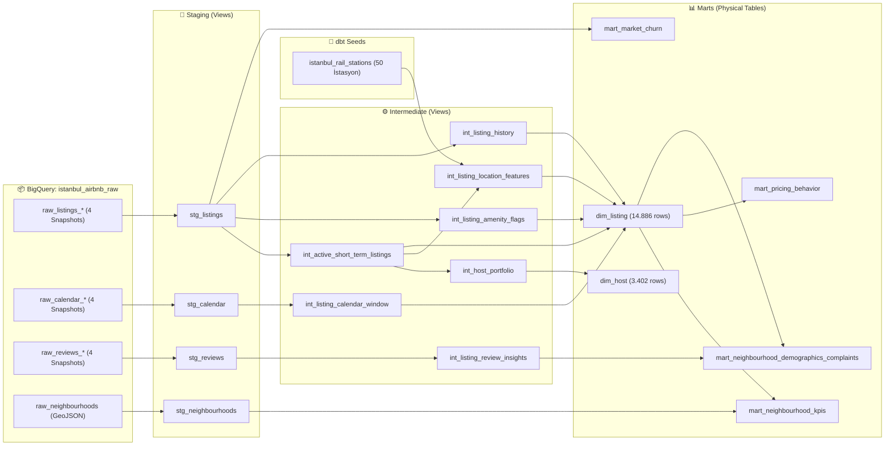

# 🏙️ İstanbul Kısa Dönem Kiralık Pazarı: Kim Kazanıyor, Neden?
*(Istanbul Short-Term Rental Market Analysis — End-to-End Analytics Engineering Project)*

Bu proje, **Inside Airbnb İstanbul** verilerini (Eylül 2025 – Haziran 2026 arası 4 dönem, ~101 bin ilan kaydı, ~37 milyon takvim satırı ve ~2,17 milyon yorum) kullanarak **Google BigQuery**, **dbt Core (1.12.5)** ve **Looker Studio** üzerinde uçtan uca inşa edilmiş bir **Analytics Engineering & Pazar Araştırması** portföy projesidir.

---

## 🎯 1. Projenin Amacı ve Araştırma Soruları

**Ana Soru:** *İstanbul kısa dönem kiralık pazarında bir ilanın yıllık gelirini ve doluluğunu gerçekte ne belirliyor: konum, fiyatlama davranışı, ev sahibi (host) ölçeği, misafir memnuniyeti mi, yoksa yasal düzenlemeler mi?*

| # | Araştırma Sorusu | İlgili dbt Modeli |
|---|---|---|
| **1** | **Dinamik vs. Statik Yönetim:** Sezon geçişlerinde fiyat güncelleyen ve takvimde güne özel minimum gece kuralı uygulayan ilanlar daha mı çok kazanıyor? | `mart_pricing_behavior`, `int_listing_calendar_window` |
| **2** | **Host Ölçeği:** Pazarı domine eden çok ilanli profesyonel portföyler mi, yoksa tek evini kiralayan bireysel ev sahipleri mi ilan başına daha yüksek performans gösteriyor? | `dim_host`, `int_host_portfolio` |
| **3** | **Konum, Raylı Sistem ve "Başlık Abartısı":** Taksim/Sultanahmet'e ve Metro/Tramvay/Marmaray duraklarına yürüme mesafesi geliri nasıl etkiliyor? Başlığında *"Taksim/Sultanahmet"* yazıp uzakta olan ilanlar puan kaybediyor mu? | `int_listing_location_features`, `istanbul_rail_stations` (seed) |
| **4** | **7464 Sayılı Kanun, İzin Belgesi ve Pazar Göçü (Churn):** 100 gün izin sınırı pazarı nasıl ikiye böldü? İzin numarası alanındaki veri tutarlılığı nasıl ve 9 ayda hangi ilanlar pazardan silindi? | `int_active_short_term_listings`, `mart_market_churn` |
| **5** | **Kalite Eşiği, Turist Profili ve Şikayet Röntgeni:** Puanı `4.50`'nin altına düşen ilanlar ne kadar gelir kaybediyor? 496 bin yorumun dil/alfabe dağılımı ve düşük puanlı evlerdeki ana şikayetler neler? | `int_listing_review_insights`, `mart_neighbourhood_demographics_complaints` |

---

## 🏗️ 2. Veri Mimarisi ve dbt Soy Ağacı (DAG)

Tüm altyapı **GCP `istanbul-airbnb` (EU bölgesi)** üzerinde çalışmaktadır. Ham veriye (`istanbul_airbnb_raw`) dbt tarafından asla yazılmaz; tüm dönüşümler `staging (view) → intermediate (view) → marts (table)` katmanlarıyla gerçekleştirilir ve **51 otomatik veri kalitesi testi (`dbt test`)** ile doğrulanır.



---

## ⚠️ 3. Veri Kalitesi ve Mühendislik Kararları (Data Quality Notes)

Ham verinin keşfi sırasında tespit edilen ve doğrudan dbt modellerinde çözülen **8 kritik veri kalitesi bulgusu**:

1. **Aktif Kısa Dönem Havuzu (`int_active_short_term_listings`):** Haziran 2026'daki 26.631 ilanın tamamı aktif kısa dönem değildir. Analiz havuzu şu 5 kuralla tanımlanmıştır: `source = 'city scrape'`, `minimum_nights <= 30`, `price IS NOT NULL`, `room_type IN ('Entire home/apt', 'Private room')` ve `price_quote_nights <= 30`. Sonuç: **14.886 aktif kısa dönem ilan** (11.070 tüm ev + 3.816 özel oda).
2. **Snapshot'lar Arası Şema Uyumsuzluğu:** BigQuery auto-detect yüklemesinde `price` kolonu Eylül 2025'te `INT64`, Aralık 2025'te `STRING`, 2026'da `FLOAT64` olarak; `host_since` ve `instant_bookable` ise farklı tiplerde oluşmuştur. `stg_listings` modelinde tüm dönemler önce `STRING` üzerinden birleştirilip (`UNION ALL`) tek bir `cleaned` katmanında `SAFE_CAST` ile standartlaştırılmıştır.
3. **Aralık 2025 Fiyat Boşluğu ve 2026 Ölçüm Değişikliği:** Aralık 2025 snapshot'ındaki 30.465 satırın tamamında `price` kolonu `NULL`'dur. Ayrıca 2026'da Inside Airbnb fiyat çekme yöntemini (`price_quote_*` sahte rezervasyon teklifi) değiştirdiği için Eylül 2025 → Mart 2026 arasında yapay bir sıçrama vardır. Bu nedenle **dönemsel fiyat karşılaştırması yalnızca aynı yöntemle ölçülen Mart 2026 – Haziran 2026 (aynı tüm evlerde medyan `+%6`) arasında yapılmıştır.**
4. **Uzun Konaklama Teklifi Sapması (~5× Düşük Fiyat):** 2026 snapshot'larında teklif süresi >30 gece olan 8 ilanda aylık indirimli fiyat gece sayısına bölündüğü için gecelik fiyat ~5× düşük görünmektedir (`₺880` vs pazar medyanı `₺4.691`). `price_quote_nights <= 30` kuralıyla bu gürültü temizlenmiştir.
5. **Para Birimi Gösterimi:** Ham veride `price` kolonu `$` işareti taşısa da `price_quote_raw` içindeki `₺` sembolüyle doğrulandığı üzere **tüm fiyatlar Türk Lirası (TL)** cinsindendir.
6. **Mart 2026 Kısmi Snapshot:** Mart 2026'da yalnızca 14.340 ilan taranmıştır (`is_partial_snapshot = TRUE`). Pazar büyüklüğü / toplam arz analizlerinden çıkarılmış, yalnızca ilan bazlı (`listing_id` eşleşmeli) fiyat değişimi analizinde kullanılmıştır.
7. **Takvim Penceresi Artefaktı (`int_listing_calendar_window`):** Takvimde fiyat kolonu yoktur ve `available = false` rezervasyon değil **"kapalı gün"** demektir. Ayrıca ev sahipleri takvimlerini 3, 6, 9 veya 12 ay ileriye kadar açık tutmaktadır; son müsait günden sonrası otomatik `false` görünür. Bu yüzden kapalı gün oranı 365 gün üzerinden değil, **her ilanın kendi açık takvim penceresi (`window_days`) içinde (`closed_day_rate_in_window`)** hesaplanmıştır.
8. **Yorumlarda Survivorship Bias (~%19,5 Kayıp):** Eylül 2025'ten Haziran 2026'ya kadar platformdan silinen ilanlarla birlikte geçmiş yılların yorumlarının ~%19,5'i de veri setinden düşmektedir. Kayıp her yılda aynı oranda gerçekleştiği için yorum hacmi mutlak sayı olarak değil, **büyüme oranı (`+%35–36 YoY`) ve pay (%)** olarak raporlanmıştır.

---

## 🔍 4. Temel Pazar Bulguları (Haziran 2026 — 14.886 Aktif İlan)

### 4.1. Dinamik Yönetim vs. Statik Fiyatlama (Tüm Evler)
Mart → Haziran 2026 fiyat güncelleme davranışı ve takvimde güne özel dinamik `minimum_nights` kullanımı:

| Mart → Haziran Fiyat Davranışı | Dinamik Min. Gece (`has_dynamic_min_nights`) | İlan Sayısı | Medyan Gecelik Fiyat | Medyan Dolu Gün | **Medyan Yıllık Gelir** |
|---|---|---|---|---|---|
| **Statik Fiyat** *(Değişim <%1)* | `False` *(Sabit)* | 372 | ₺4.136 | 78 gün | **₺315.324** |
| **Statik Fiyat** *(Değişim <%1)* | **`True` *(Esnek)*** | 86 | ₺4.565 | **102 gün** | **₺541.368 (+%72)** |
| **Ilımlı Artış** *(+%1..%15)* | `False` *(Sabit)* | 2.492 | ₺4.488 | 72 gün | **₺307.459** |
| **Ilımlı Artış** *(+%1..%15)* | **`True` *(Esnek)*** | 531 | ₺5.312 | **132 gün** | **₺583.949 (+%90)** |
| **Yüksek Artış** *(>=+%15)* | `False` *(Sabit)* | 1.999 | ₺5.685 | 66 gün | **₺351.621** |
| **Yüksek Artış** *(>=+%15)* | **`True` *(Esnek)*** | 756 | **₺6.640** | **108 gün** | **₺720.594 (+%105)** 🏆 |

> **Bulgu:** Takviminde hafta sonu ve sezona göre esnek minimum gece kuralı uygulayan ve sezona girerken fiyatını güncelleyen ev sahipleri, statik yönetilen evlere kıyasla **yılda 2 katına varan (`₺720.594` vs `₺315.324`) gelir** elde etmektedir.

---

### 4.2. Host Ölçeği: "Butik Kalite" vs. "Sürümden Kazanma"
İstanbul kısa dönem kiralık pazarının **%91,6'sı** birden fazla ilanı olan portföy sahiplerinin kontrolündedir. Sadece **88 profesyonel host (21+ ilan)** pazarın **%22,6'sını (3.367 ilan)** yönetmektedir:

| Host Segmenti | Host Sayısı | İlan Sayısı | Pazar Payı | Medyan Puan | Medyan Dolu Gün | **İlan Başı Medyan Yıllık Gelir (Tüm Ev)** |
|---|---|---|---|---|---|---|
| **1) Bireysel (1 ilan)** | 1.256 | 1.256 | **%8,4** | **4,87** | **84 gün** | **₺513.669** 🏆 |
| **2) Küçük Portföy (2–5 ilan)** | 1.354 | 3.924 | %26,4 | 4,80 | 72 gün | ₺416.208 |
| **3) Orta Portföy (6–20 ilan)** | 704 | 6.339 | **%42,6** | 4,76 | 60 gün | ₺305.748 |
| **4) Profesyonel (21+ ilan)** | 88 | 3.367 | %22,6 | 4,78 | 60 gün | **₺286.836** |

> **Bulgu:** Profesyonel portföyler toplam hacimden kazanırken, **ilan başına performansta tek evini yöneten bireysel hostlar** daha yüksek misafir puanı (`4,87` vs `4,78`), daha yüksek doluluk (`84` vs `60` gün) ve **+%79 daha yüksek yıllık gelir (`₺513.669` vs `₺286.836`)** sağlamaktadır.

---

### 4.3. Konum, Raylı Sisteme Yakınlık (`dbt seed`) ve İlçe Yoğunluğu (`GeoJSON`)
- **Beyoğlu Yoğunluğu vs. Kadıköy Gelir Liderliği:** Beyoğlu yalnızca **$8,99\text{ km}^2$** alanda **4.353 aktif tüm ev** (**$\text{km}^2$ başına 484,2 ev!**) barındırırken medyan yıllık geliri `₺406.980`'dir. Yoğunluğu $28,7\text{ ev/km}^2$ olan **Kadıköy** ise **₺615.600 medyan yıllık gelir** ile İstanbul'un en kârlı tüm ev pazarıdır.
- **Metro / Tramvay / Marmaray Etkisi:** Bir raylı sistem istasyonuna **`<= 400m` (~5 dk yürüme)** mesafedeki tüm evler yılda medyan **96 gün** doluluk ve **₺453.340 gelir** elde ederken, `801–1500m` mesafedeki evlerde doluluk **60 güne**, gelir ise **₺246.600'e** düşmektedir.
- **Başlık Abartısı (`Clickbait`) Cezası:** İlan başlığında *"Sultanahmet"* yazmasına rağmen Sultanahmet Meydanı'na kuş uçuşu `> 1,5 km` uzakta olan ilanların ortalama **Konum Puanı (`review_scores_location`) `4,65`'ten `4,34`'e** düşmektedir.
- **Manzara Primi:** Hem su (Boğaz/Deniz) hem şehir silüeti manzarası beyan eden tüm evler, manzarasız evlere göre gecelik fiyatta **1,64× (`₺7.368` vs `₺4.489`)**, yıllık gelirde ise **2,8× (`₺844.050` vs `₺301.530`)** fark yaratmaktadır.

---

### 4.4. Kalite Eşiği (`4.50`), Turist Demografisi ve Şikayet Röntgeni
- **`4.50` Puan Uçurumu:** Puanı `4.50–4.79` bandından `4.00–4.49` bandına düşen tüm evlerde medyan dolu gün **84 günden 42 güne**, yıllık gelir ise **₺387.541'den ₺158.724'e (-%59)** çakılmaktadır.
- **496.906 Yorumda Şikayet Röntgeni (`< 4.00` vs `4.80+` Evler):**
  - *Yokuş/Merdiven* (`2,93%` vs `1,03%`) ve *Sokak Gürültüsü* (`2,84%` vs `2,73%`) yüksek puanlı evlerin yorumlarında da geçmekte ancak **puan düşürmemektedir**.
  - Bir evi `< 4.00` puana düşüren 3 ana faktör: **Temizlik/Böcek şikayetlerinin 21,4 katına çıkması (`0,28% → 6,00%`)**, **Koku/Rutubet şikayetlerinin 7 katına çıkması (`0,64% → 4,39%`)** ve **Sıcak su/Wifi/Klima arızalarının 10 katına çıkmasıdır (`0,10% → 1,03%`)**.
- **Turist Profili Haritası:** **Fatih (`%80,1`)** ve **Beyoğlu (`%75,8`)** Batı/İngilizce yorumların merkeziyken, **Şişli (`%11,6`)** Arapça yorum oranında İstanbul lideridir (Fatih'in 9 katı). **Kadıköy (`%44,9`)**, **Beşiktaş (`%38,8`)** ve **Adalar (`%63,3`)** ise Türkçe (yerli misafir) payının en yüksek olduğu ilçelerdir.

---

### 4.5. 7464 Sayılı Kanun (100 Gün Eşiği), İzin Numarası Tutarlılığı ve Churn
- **100 Gün Kümelenmesi:** Tüm 26.631 ilanın **%36,7'si (9.776 ilan)** tam `minimum_nights = 100` değerinde kümelenmiştir (7464 sayılı Kanun'daki 100 gün izin belgesi sınırının pazardaki doğrudan izi). *(Not: Veri setimiz Eylül 2025'te başladığı ve yasa Ocak 2024'te yürürlüğe girdiği için yasa öncesi-sonrası nedensellik iddiası kurulmamış, mevcut pazar yapısı betimlenmiştir).*
- **İzin Numarası Tutarlılığı (`license_status`):** Aktif kısa dönem havuzundaki ilanların yalnızca **%10,4'ünde (1.546 ilan)** sadece tek bir ilanda kullanılan İstanbul formatlı (`34-XXXX`) izin numarası (`istanbul_tekil`) vardır ve bu grup **₺528.144 medyan yıllık gelir** ile en yüksek performansı göstermektedir. İlanların **%21,7'si (3.234 ilan)** farklı hostlar arasında paylaşılan `34-XXXX` numaraları, **%23,5'i** işletme belgesi formatı, **%1,2'si (173 ilan)** ise `12-3456` gibi yer tutucu numaralar (`₺238.464` gelir) içermektedir.
- **9 Aylık Pazar Göçü (`mart_market_churn`):** Eylül 2025'teki aktif kısa dönem ilanların **%67,7'si** Haziran 2026'da da aktif kısa dönemde kalmış, **%29,6'sı (4.115 ilan)** ise 9 ay içinde platformdan tamamen silinmiştir (`Churn`).

---

## 🛠️ 5. Kurulum ve Çalıştırma Rehberi (Setup Guide)

### 5.1. Yerel Kurulum (dbt Core — Windows / PowerShell)

1. **Repoyu klonlayın ve sanal ortamı kurun:**
   ```powershell
   git clone https://github.com/omowalee/istanbul-airbnb-market-analysis.git
   cd istanbul-airbnb-market-analysis
   python -m venv venv
   .\venv\Scripts\Activate.ps1
   python -m pip install dbt-core==1.12.5 dbt-bigquery==1.12.1 google-cloud-bigquery requests
   ```
2. **Google Cloud OAuth kimlik doğrulamasını yapın:**
   ```powershell
   gcloud auth application-default login
   ```
3. **`~/.dbt/profiles.yml` dosyasını yapılandırın:**
   `C:\Users\<kullanici_adi>\.dbt\profiles.yml` içine aşağıdaki tanımı ekleyin (kendi geliştirme şemanızı `dbt_numan` / `dbt_abi` olarak belirtin):
   ```yaml
   istanbul_airbnb:
     target: dev
     outputs:
       dev:
         type: bigquery
         method: oauth
         project: istanbul-airbnb
         dataset: dbt_numan
         location: EU
         threads: 4
         job_execution_timeout_seconds: 300
   ```
4. **Bağlantıyı doğrulayın, seed ve modelleri çalıştırın:**
   ```powershell
   cd istanbul_airbnb
   dbt debug
   dbt seed
   dbt run
   dbt test
   ```

### 5.2. dbt Cloud Kurulumu (Ekip İşbirliği İçin)
- **GCP Project ID:** `istanbul-airbnb`
- **Dataset Location:** `EU` *(Kritik: Tüm ham tablolar EU bölgesindedir)*
- **Development Dataset:** `dbt_abi`
- **Project Subdirectory:** `istanbul_airbnb`
- **dbt Version:** `1.12` (Fusion olmayan standart sürüm)

---

## 📈 6. Looker Studio Pano Mimarisi (4 Sayfa)

Looker Studio panosu doğrudan `marts` katmanındaki fiziksel tablolara bağlanır:
1. **Sayfa 1 — Pazar Özeti & Coğrafi Yoğunluk (`mart_neighbourhood_kpis`, `dim_listing`):** İlçe poligon haritası (`listings_per_km2`), Avrupa vs. Anadolu yakası karşılaştırması, izin belgesi (`license_status`) dağılımı.
2. **Sayfa 2 — Fiyatlama, Dinamik Yönetim & Manzara Primi (`mart_pricing_behavior`):** Mart → Haziran fiyat değişimi grupları, dinamik `minimum_nights` etkisi, Boğaz/Deniz ve Şehir Silüeti manzarası primleri.
3. **Sayfa 3 — Host Ölçeği & Ulaşım Analizi (`dim_host`, `dim_listing`):** Bireysel vs. Profesyonel host gelir/puan karşılaştırması, Taksim/Sultanahmet mesafe halkaları ve Metro/Tramvay (`rail_distance_band`) yürüme mesafesi etkisi.
4. **Sayfa 4 — Misafir Deneyimi, Turist Demografisi & Churn (`mart_neighbourhood_demographics_complaints`, `mart_market_churn`):** `4.50` puan eşiği kırılımı, ilçelere göre turist dili/alfabesi dağılımı, düşük puanlı evlerdeki şikayet nedenleri ve Eylül 2025 → Haziran 2026 pazar göçü.
